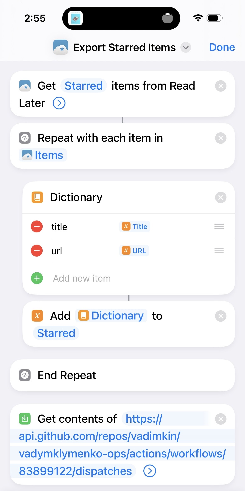
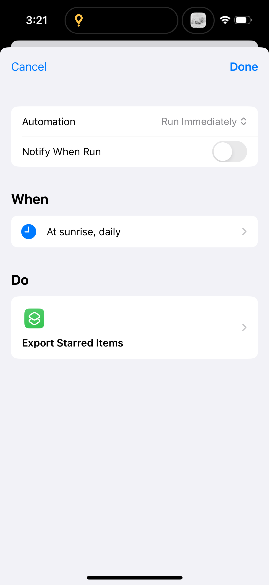

# vadymklymenko.com ops scripts

## Description

This repository contains scripts for managing some features personal.

### Reeder exporter

This is a Shortcut script (triggered automatically daily) to export all starred articles from Reeder into json.

|   |  |
| ------------- | ------------- |

### Goodreads parser

This is a simple parser for goodreads.com (`goodreads-books/run_public.py`), run daily via GitHub Actions.
Goodreads no longer serves the shelf RSS and the shelf pages require sign-in, so it reads only public pages:

- `data/reading.json` — currently reading, with `progress` (percent) when one is posted. The list comes from the
  grid widget; title, author, ownership, start date and progress come from the "Currently Reading" block of the
  public profile (`/user/show/USER_ID`).
- `data/up_next.json` — the 8 most recently added books on the `to-read` shelf, from the grid widget
  (`/review/grid_widget/USER_ID?shelf=to-read`). A new book's author comes from its public book page.
- `data/read.json` — currently reading on top, then the saved finished books.
- `data/top_rated.json` — top rated books (4-5 stars) from `read.json`.

If a fetch fails or a block is missing, the previous data is kept instead of being wiped.
Finished books, ratings and `bookcrossing.json` can't be read publicly any more, so they keep their last saved values.

This data is used to render [bookshelf](https://vadymklymenko.com/bookshelf/) on my personal website and for some other useful purposes.
